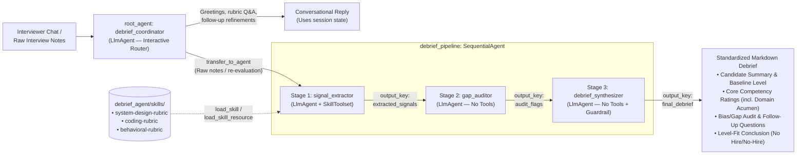

# Candidate Debrief & Rubric Synthesizer (Google ADK)

A modular, production-ready **Enterprise Agents** reference implementation built with the **Google Agent Development Kit (`google-adk`)** and **ADK Agent Skills (`SkillToolset`)**.

It transforms messy, unstructured technical interview notes into objective, rubric-aligned candidate debriefs—while auditing for subjective bias, tracking hint reliance, identifying unassessed competencies, and strictly keeping hiring decisions with human interviewers.

---

## Problem & Solution

**The Problem:**
Technical interviewers often finish a 45-minute interview with fragmented shorthand notes. Turning those notes into calibrated, level-specific feedback is slow, inconsistent across interviewers, and prone to subtle pitfalls: subjective phrasing (*"seemed nervous"*, *"good culture fit"*), uncredited interviewer hints, and missed rubric competencies.

**The Solution:**
This agent pairs an interactive conversational coordinator (`debrief_coordinator`) with a **deterministic 3-stage `SequentialAgent` pipeline (`debrief_pipeline`)** and **progressive disclosure via ADK Agent Skills (`SkillToolset`)**:
- **Interactive Conversational Entry Point (`debrief_coordinator`):** Handles greetings, rubric questions, missing-notes guidance, and follow-up questions on prior debriefs naturally—and delegates raw interview notes directly to `debrief_pipeline`.
- **Progressive Rubric Loading (L1 → L2 → L3):** Only the matching interview rubric (`system-design-rubric`, `coding-rubric`, or `behavioral-rubric`), its level-specific behavioral anchors (`l3-anchors.md` / `l4-anchors.md` / `l5-anchors.md`), and its Markdown template are loaded into context on demand.
- **Strict Tool & Context Isolation:** Only Stage 1 (`signal_extractor`) holds `SkillToolset`. Stage 2 (`gap_auditor`) and Stage 3 (`debrief_synthesizer`) have zero tools and `include_contents="none"`, operating strictly on structured session state.
- **Human-in-the-Loop Guardrail & Clean Rendering:** A deterministic `after_model_callback` (`enforce_no_hire_guardrail` + `normalize_markdown_output` in `debrief_agent/callbacks.py`) prohibits Hire / No-Hire verdicts while normalizing Markdown for ADK Web and Gemini Enterprise.

### Extensibility via ADK Skills (Rules as Data, Not Hardcoded Prompts)
Rather than hardcoding hiring rubrics, level bars, or report templates inside Python agent instructions, **all evaluation rules are encoded as self-contained ADK Agent Skills** under `debrief_agent/skills/` (`SKILL.md` + `references/` + `assets/`). Because `build_rubric_toolset()` dynamically discovers every skill folder via `load_skill_from_dir`, you can extend the agent **with zero Python code changes**:
- **Add new seniority levels:** Drop a new anchor file (e.g., `references/l6-anchors.md`) into an existing rubric skill and reference it in its `SKILL.md`.
- **Add new interview rounds or domain tracks:** Create a new folder under `debrief_agent/skills/` (e.g., `ml-engineering-rubric/` or `security-design-rubric/`) with its own `SKILL.md`, `references/`, and `assets/debrief-template.md` — it is automatically registered in `SkillToolset` on startup.
- **Customize company templates & calibration bars:** Edit the Markdown anchor or template files directly without modifying orchestration or tool logic.

---

## Architecture



---

## Project Structure

```text
candidate-debrief-synthesizer/
├── pyproject.toml
├── .env.example
├── .gitignore
├── README.md
├── Dockerfile
├── .cloudbuild/                  # Cloud Build CI/CD pipelines (PR, staging, prod)
├── deployment/terraform/         # Agent Runtime + Telemetry Terraform IaC
├── examples/
│   └── sample_l5_system_design_notes.txt
├── tests/
│   ├── unit/test_pipeline.py     # Deterministic architecture, skill & guardrail tests
│   └── eval/                     # ADK eval config & debrief dataset
└── debrief_agent/
    ├── __init__.py
    ├── agent.py                  # debrief_coordinator + debrief_pipeline + App
    ├── sub_agents.py             # signal_extractor, gap_auditor, debrief_synthesizer
    ├── callbacks.py              # OTel tracing, state init, no-Hire guardrail & Markdown sanitizer
    ├── fast_api_app.py           # FastAPI + ADK Web + A2A + Reasoning Engine adapter
    └── skills/
        ├── system-design-rubric/
        │   ├── SKILL.md
        │   ├── references/
        │   │   ├── l3-anchors.md
        │   │   ├── l4-anchors.md
        │   │   └── l5-anchors.md
        │   └── assets/
        │       └── debrief-template.md
        ├── coding-rubric/
        │   ├── SKILL.md
        │   ├── references/
        │   │   ├── l3-anchors.md
        │   │   ├── l4-anchors.md
        │   │   └── l5-anchors.md
        │   └── assets/
        │       └── debrief-template.md
        └── behavioral-rubric/
            ├── SKILL.md
            ├── references/
            │   ├── l3-anchors.md
            │   ├── l4-anchors.md
            │   └── l5-anchors.md
            └── assets/
                └── debrief-template.md
```

---

## Quickstart (`uv`)

### 1. Prerequisites
- Python 3.12+
- [`uv`](https://docs.astral.sh/uv/getting-started/installation/)
- Either Google Cloud ADC (`gcloud auth application-default login`) for Vertex AI **or** a Gemini API key from Google AI Studio.

### 2. Install Dependencies
```bash
uv sync
```

### 3. Configure Environment
Copy `.env.example` to `.env` and fill in your credentials (never commit `.env`):
```bash
cp .env.example .env
```

By default, the agent uses `ADK_MODEL=gemini-3.8-flash` (configurable via `.env`).

---

## Testing Locally

### Option 1: ADK Web UI (`uv run adk web`)
Launch the interactive ADK developer UI from the repository root:
```bash
uv run adk web
```
1. Open the local URL printed in the terminal (typically `http://127.0.0.1:8000`).
2. Select **`debrief_agent`** from the agent dropdown.
3. Paste the contents of [`examples/sample_l5_system_design_notes.txt`](examples/sample_l5_system_design_notes.txt) into the chat box.
4. Inspect the **Events / State** tab to watch:
   - `signal_extractor` call `load_skill("system-design-rubric")` and `load_skill_resource(...)` for `references/l5-anchors.md` and `assets/debrief-template.md`.
   - `gap_auditor` flag the subjective remark (*"seemed a bit hesitant at first, maybe nervous"*, *"good culture fit"*), the hint-assisted resilience design, and the unassessed **Security, Governance & Operational Excellence** competency.
   - `debrief_synthesizer` output the standardized Markdown debrief with targeted follow-up questions and no Hire/No-Hire verdict.

### Option 2: Agents CLI Playground, Run, or Eval
```bash
# Interactive playground via agents-cli
agents-cli playground

# One-shot run from the terminal with the sample notes
agents-cli run "$(cat examples/sample_l5_system_design_notes.txt)"

# Run unit tests (deterministic, no LLM calls)
uv run pytest tests/unit

# Run ADK evaluation suite (guardrail + completeness + LLM-as-judge)
agents-cli eval run --dataset tests/eval/datasets/debrief-dataset.json
```

### Sample Prompts to Try Locally
1. **Conversational / Interactive Check** *(handled directly by `debrief_coordinator`, no pipeline triggered)*:
   > `Hi! What interview rubrics and levels do you support?`
2. **Guided Onboarding** *(prompts you for raw notes & level)*:
   > `I want to evaluate an L4 Cloud AI Engineer candidate.`
3. **Full L5 System Design Debrief** *(triggers `debrief_pipeline` + `system-design-rubric`)*:
   > Paste the contents of [`examples/sample_l5_system_design_notes.txt`](examples/sample_l5_system_design_notes.txt)
4. **L3 Coding Round with Bias & Hint Signals** *(triggers `coding-rubric` + `l3-anchors.md`)*:
   > `Evaluate this candidate for L3 Coding: Candidate was very energetic and likable. Clarified input list format and wrote a clean O(n) hash map solution in Python. Declared done without tracing an example; after I prompted about empty lists, added a guard check. Never tested duplicate keys or null inputs.`
5. **Follow-Up / Level Recalibration** *(multi-turn session state)*:
   > `Why did you flag that phrase in the bias audit?`
   > `Now re-evaluate those same notes at L4 and emphasize Domain-Specific Acumen.`

---

## Deploying to Agent Runtime & Publishing to Gemini Enterprise

Install the [`google-agents-cli`](https://pypi.org/project/google-agents-cli/) toolchain (one-time):
```bash
uv tool install google-agents-cli
```

### 1. Pre-Flight Dry Run
Validate lockfile, required GCP APIs, and IAM permissions without modifying cloud resources:
```bash
agents-cli deploy \
  --project YOUR_PROJECT_ID \
  --region us-central1 \
  --dry-run
```

### 2. Deploy to Agent Runtime (Agent Engine)
Deploy the containerized agent to **Agent Runtime** (auto-registers the A2A agent card in Agent Registry and writes `deployment_metadata.json` locally):
```bash
agents-cli deploy \
  --project YOUR_PROJECT_ID \
  --region us-central1
```
*(Optional: add `--min-instances 1` to keep a warm instance and eliminate cold starts, or run `agents-cli infra single-project --apply --project YOUR_PROJECT_ID` **before** your first deploy to provision Terraform-managed GCS/BigQuery prompt-response logging and BigQuery Agent Analytics.)*

### 3. Publish to Gemini Enterprise
List existing Gemini apps in your project to find your `--gemini-app-id`:
```bash
agents-cli publish gemini --list --project-id YOUR_PROJECT_ID
```

Register the deployed Agent Runtime natively via ADK (`:streamQuery`, auto-detecting `--agent-runtime-id` from `deployment_metadata.json`):
```bash
agents-cli publish gemini \
  --gemini-app-id projects/YOUR_PROJECT_NUMBER/locations/global/collections/default_collection/engines/YOUR_APP_ID \
  --display-name "Candidate Debrief Synthesizer" \
  --description "Transforms raw technical interview notes into objective, rubric-aligned L3/L4/L5 candidate debriefs with bias/gap auditing and targeted follow-up questions."
```

### 4. Smoke-Test the Deployed Endpoint
```bash
agents-cli run --mode adk "Hi, what can you help me with?"
```

---

## Enterprise Evaluation Criteria Coverage

| Criterion | Implementation Highlights |
| :--- | :--- |
| **Tool & Interface Design** | Progressive-disclosure ADK Skills (`SkillToolset` + `load_skill_from_dir`) with strict tool isolation (only `signal_extractor` holds `rubric_toolset`), plus FastAPI, ADK Web, Reasoning Engine adapter, and A2A serving surfaces (`debrief_agent/fast_api_app.py`). |
| **Context & Memory** | L1 → L2 → L3 progressive rubric loading (`l3`/`l4`/`l5` anchors loaded on demand); `include_contents="none"` context isolation on Stages 2–3 to prevent raw tool-call bloat; `before_agent_callback` / `after_agent_callback` safe state initialization and bounded multi-turn `debrief_history`; shared session & artifact services (`debrief_agent/app_utils/services.py`). |
| **Orchestration & Logic** | Deterministic 3-stage `SequentialAgent` (`signal_extractor` → `gap_auditor` → `debrief_synthesizer`) with `temperature=0.1`, explicit session-state handoffs (`extracted_signals` → `audit_flags` → `final_debrief`), deterministic `after_model_callback` (`enforce_no_hire_guardrail`) redacting any prohibited Hire/No-Hire verdict, and unit + eval test suites (`tests/unit/test_pipeline.py`, `tests/eval/`). |
| **Observability & Tracing** | OpenTelemetry tracing (`otel_to_cloud` + custom span attributes `debrief.stage.*`, `debrief.skill.*`, `debrief.guardrail.no_hire_triggered` in `debrief_agent/callbacks.py`), structured JSON logs, Cloud Trace + GCS/BigQuery prompt-response logging (`deployment/terraform/single-project/telemetry.tf`), and optional `BigQueryAgentAnalyticsPlugin` wired into `App` (`debrief_agent/agent.py`). |
| **Infrastructure & CI/CD** | Containerized `Dockerfile` (`uv sync --frozen`), Terraform IaC for **Agent Runtime** (`deployment/terraform/single-project/` and `deployment/terraform/cicd/`), **Google Cloud Build** pipelines (`.cloudbuild/pr_checks.yaml`, `.cloudbuild/staging.yaml`, `.cloudbuild/deploy-to-prod.yaml`), and load test harness (`tests/load_test/`). |
